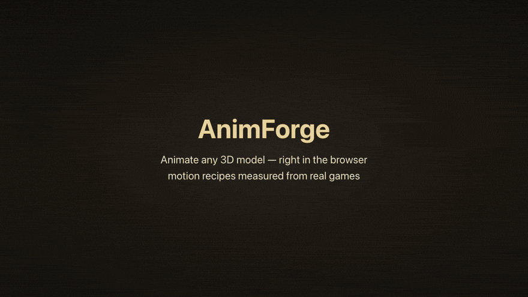
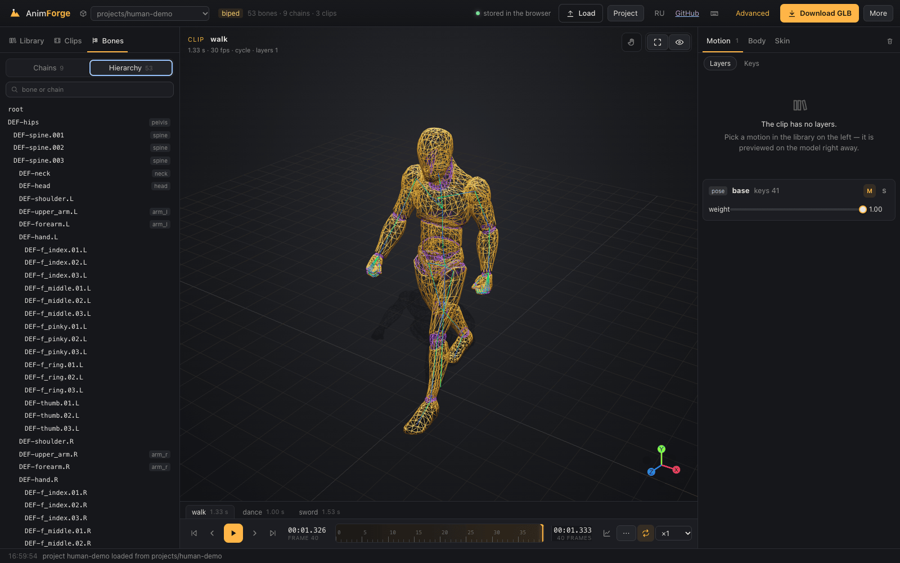
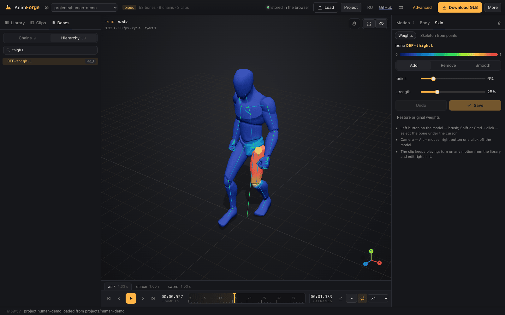
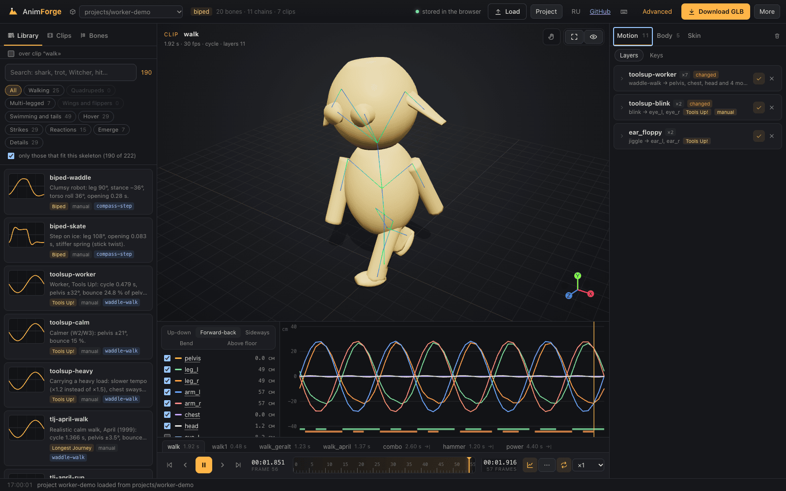
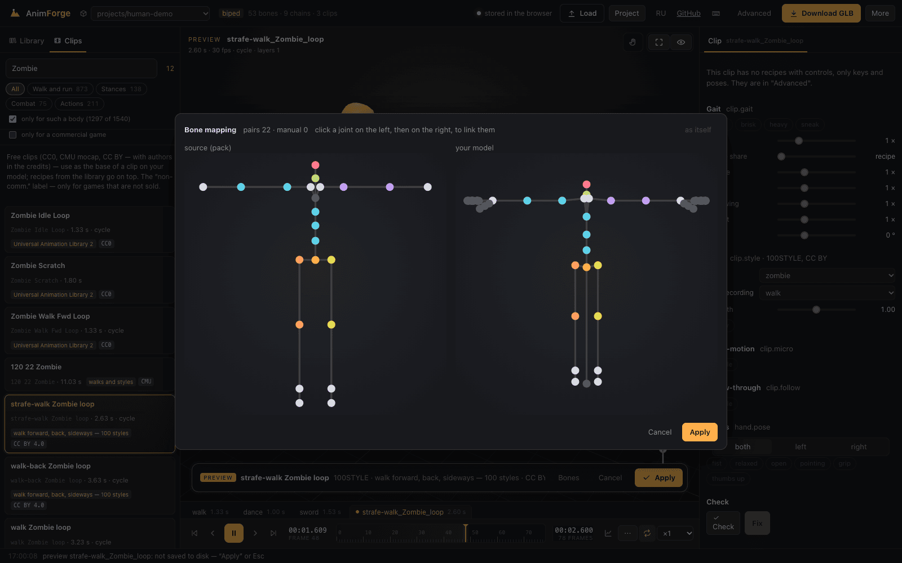
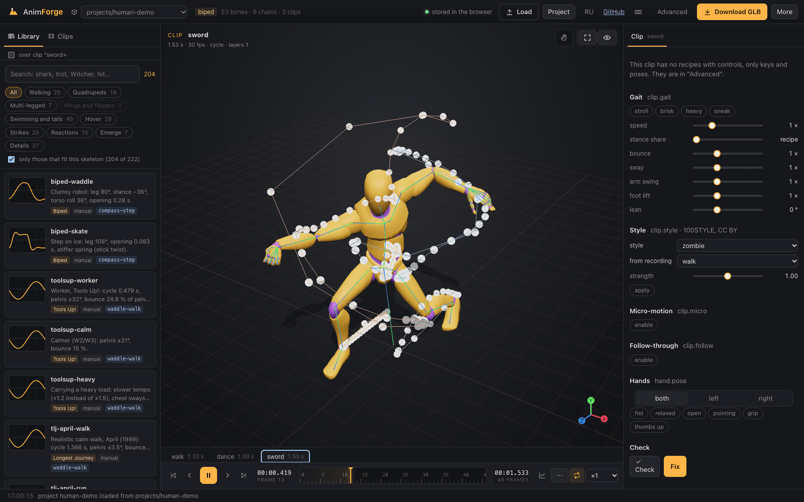
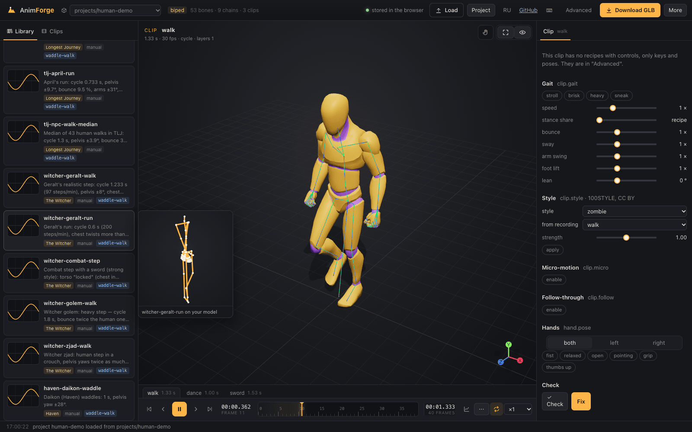
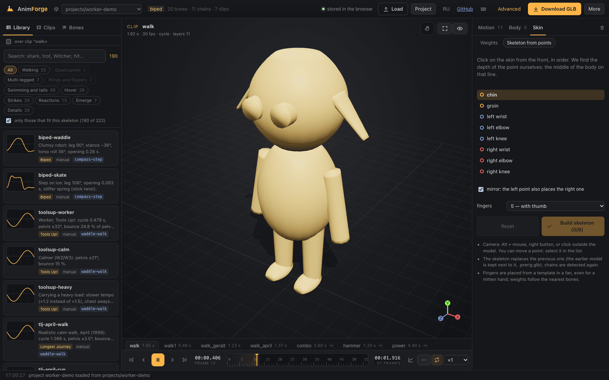

# AnimForge

[Русский](README.md) · **English**

**[▶ Open in the browser](https://bloodrabbid.github.io/AnimForge/)** — no install: recipes, clip packs, editing, GLB export.

[](docs/demo-en.mp4)

<sub>45 seconds; click the image for the same video in full quality (MP4). Recorded by a script: `pnpm site && pnpm demo:video`.</sub>

### What's inside

<table>
<tr><td width="50%"><a href="docs/screens/en/1-rig-hierarchy.png"></a><br><sub>Rig: wireframe, skeleton and all 53 bones, each with its chain</sub></td><td width="50%"><a href="docs/screens/en/2-weight-paint.png"></a><br><sub>Skin weight painting: red — the bone fully drives the skin</sub></td></tr>
<tr><td width="50%"><a href="docs/screens/en/3-layers-limb-curves.png"></a><br><sub>A walk built from 11 layers; the graph shows pelvis, legs and arms each in its own phase, bars — foot contact</sub></td><td width="50%"><a href="docs/screens/en/4-bone-mapping.png"></a><br><sub>Retargeting a clip to a different skeleton: 22 bone pairs matched automatically</sub></td></tr>
<tr><td width="50%"><a href="docs/screens/en/5-limb-trails.png"></a><br><sub>Limb trails: hand and foot paths over the whole strike</sub></td><td width="50%"><a href="docs/screens/en/6-preset-preview.png"></a><br><sub>Hover a preset — preview on your model's skeleton</sub></td></tr>
<tr><td width="50%"><a href="docs/screens/en/7-rig-by-points.png"></a><br><sub>Skeleton from 8 points on the skin: chin, groin, wrists, elbows, knees</sub></td><td></td></tr>
</table>

An animation tool for any game: parametric recipes + a hand-edit layer + clips, glTF export, verification in Godot.
One command core (`packages/core`) — called by the CLI, MCP and the web UI.

## Quick start

```sh
pnpm install
P=projects/fish-demo
pnpm af help                                   # all commands with arguments (JSON)
pnpm af info --project $P                      # bones, chains, clips
pnpm af preset.list --project $P               # library presets
pnpm af recipe.set --clip swim --layer wave --params '{"period":1.6}' --project $P
pnpm af key.set --clip swim --bone spine_5 --axis lateral --t 1.0 --v 25 --project $P
pnpm af sheet --clip swim --view top --out out/swim.png --project $P   # "eyes": a frame sheet via Blender
pnpm af export --out out/fish.glb --project $P                         # glTF for Blender/Godot/any engine (.fbx — FBX)
pnpm af verify --project $P                                            # check in Godot, headless
```


## Site: AnimForge by link

**https://bloodrabbid.github.io/AnimForge/** — the same editor with no install: all recipes and library presets, tweens,
packs of ready-made clips (CC0, CMU, CC BY, CC BY-NC — author and license on the card), demo models, editing, checks and
GLB export. Bring your own model — a `.glb` with a skeleton (drag it into the window). Projects are stored in this browser; to take one with you,
use "Project" → single file.

How it works: the "server" is a Service Worker in the browser. It answers the page's requests to `api/…` with the same handler as
the dev server (`apps/web/routes.ts`), and an in-memory file system replaces the disk.

```
page ──api/…──▶ Service Worker (sw/sw.ts) ──▶ routes.ts ──▶ core and CLI ──▶ browser memory (/af)
                                   ▲ library and demos — from the site at startup, clip packs — on demand
                                   ▲ your edits — from IndexedDB
```

Blender or Godot are needed only locally (`pnpm web`): FBX/OBJ/DAE import, auto-rig, FBX, frame sheets and video,
`publish` to Godot.

```bash
pnpm site          # build into out/site
pnpm site:check    # check the build in Chrome from the /AnimForge/ subfolder, as on GitHub Pages
pnpm screens       # README screenshots (docs/screens); AF_LANG=en for English ones
```

Demo models: the human mannequins `human-demo` (opens by default) and `human-female-demo` — Quaternius, Universal Animation Library, CC0; the worker, the Biped robot, fish, snake, tentacle and quadruped are our own body templates.

Deployed by `.github/workflows/site.yml` on every push to master.
## make: from model to file in one call

```sh
pnpm af make --project out/baker --file ~/models/baker.glb \
  --clips "ленивая ходьба; удар; дыхание" \
  --style '{"stylization":"cartoon","role":"npc","fps":30}' \
  --godot ~/games/clay/godot/assets/anim --send
```

Free-text clip names (`--clips "lazy walk; strike; breathing"` in Russian above) are matched against Russian tags for now; in English, name presets directly: `--clips "walk=toolsup-heavy; idle=witcher-breathe"`.

One command does everything in order:

1. Creates the project: imports the model and auto-rigs it if there is no skeleton.
2. Builds clips from the library. If there are no anatomical limits yet, it sets them.
3. Exports a glb to `out/<name>.glb` and puts a copy into the Godot game folder.
4. Renders a video of all clips with captions to `out/<name>.mp4`.
5. With `--send`, sends the video and glb to Telegram.

**Clips** are separated by `;`:
- `name=preset{"period":0.6}` — an exact preset with parameters;
- just `preset`;
- words: "lazy walk", "golem-like walk", "shark swims".

The word search (`searchPresets` in `packages/core/src/plan.ts`) takes into account:
- the library section;
- adjectives (lazy → calm, heavy → golem);
- direct mentions;
- the body: a biped will not get a multi-legged gait;
- the style card.

Running and a power strike are chosen only if asked for. Whatever the library does not have honestly goes into `missing`. In the `summary` report, each clip lists the chosen preset and three more options.

The **style card** (`style`) and the **game folder** (`godot`) are remembered in the project; no need to repeat them. Card fields:
- `stylization`: realistic / cartoon;
- `role`: player / enemy / npc;
- `fps`, `genre`, `refs`, `notes`.

The card affects preset choice: a cartoon character gets Tools Up! movement, a realistic one gets Witcher and TLJ, an NPC gets presets with a readable telegraph (a visible wind-up before a strike).

Running `make` again with the same clip name replaces the clip, so you can edit with the same call: `--clips "walk=toolsup-heavy"`.

**Stops:**
- the model has no meshes (the file is only a skeleton);
- the rig is doubtful: no chains, or the body is not recognized. Then `make` draws the model to `out/make-rig.png` and waits for a call with `--force`.

The length of a one-shot clip comes from the recipe (`length`). A strike lasts until the input window opens, a power charge lasts in full.

## Check, fix and critic

`make` checks the clips itself after building and fixes what it can. The same by hand:

```sh
pnpm af check --project out/baker                 # report for all clips
pnpm af check --project out/baker --clip attack --fix true
pnpm af review.pack --project out/baker           # frame sheets for the critic
```

**What the code measures** (`packages/cli/src/checks.ts`). Everything is measured on the model's real skin, not on bones. 31 frames with a phase shift, so a break cannot hide between them.

| check | defect | why |
|---|---|---|
| skin | mesh edges stretched more than 1.6x on > 0.5 % of edges | compression in a fold is not a defect, stretching is |
| floor | feet go below the floor deeper than 1 % of height | the floor is the lowest mesh point at rest |
| loop seam | jump at the join over 1 % of height and 10 times the step inside the clip | |
| jerk | per-frame step more than 3 times the median and over 2 % of height (except ±0.1 s around a strike) | |
| foot slide | the character moves at the clip's natural speed, and the support foot travels over the floor more than 5 % of height per step; support moving forward ("moonwalk" gait) is a defect; a step slower than 0.15 height/s means marching in place | the measure is the core's `gaitSlide`, the same one that fits the step to speed in Godot |
| limits | a bone sits on a limit for more than 30 % of the clip | |
| timing | player strike later than 0.35 s; enemy wind-up shorter than 0.3 s; zero input window | |
| length | clip shorter than its events | |

**Fix** (`--fix true`) goes in order, from structure to strength:
1. Skin weights at joints are smoothed (`weights.smooth`). The result stays only if the skin tears at least a third less; otherwise the model is restored as it was.
2. Feet are put on the floor with IK and flat (`clip.ground` with `flat`).
3. Layers that tear the skin are weakened in steps of ×0.7. The main gait layer goes no lower than ×0.35, pelvis and chest on the floor no lower than ×0.5, so the gait does not lose its character.
4. An arm strike that tears the skin at any strength is replaced with the body ram `body-ram` (`ram-npc` / `ram-player` by role). This happens with blob characters: the arms are short, and swinging them tears the mesh. The replacement is made only if the arm is the culprit.
5. A sliding gait is first fixed by locking the support foot (`clip.ground --lock true`, below). If that is not enough — for `waddle-walk`, the leg phase is fitted to the pelvis (`legPhase` — the correct phase differs between presets), and if that is not enough — less pelvis yaw and a wider leg swing. The step must not degrade into marching in place, and the skin must not get worse.
6. A zero input window gets a `tail` of 0.3 s, and the clip is lengthened (`clip.set --fit true`).

**Report in words and advice.** Each clip has a `text` line in game units: step speed in m/s, foot travel and sinking in mm, skin, seam. Each unfixed finding has `advice`: what to change and what then happens. The advice is not a guess but a probe (`packages/cli/src/advice.ts`):
- candidates are single controls: layer weight ×0.7 / ×0.5, recipe parameter ×0.8 / ×1.25 (for a loop with `period`, the clip length changes with it), feet to the floor;
- each is measured with the same measure as the check; the two best go into the advice, parameters first, then layer weakening;
- an edit after which the skin tears more never makes it into the advice;
- the advice carries ready `steps` commands — the agent applies them as is, and the promised number is what you get (a test verifies this).

Example: "legSwing 30 → 24° (hip swing — smaller) → the foot travels 5.4 % of height (78 mm) per step". If the skin tears at any motion control, the advice is to smooth the model's weights. The idea comes from the Motion Lab report in ActionForge, but there the advice covers only foot sliding.

The **critic** judges what a number cannot measure: silhouette, weight, readability, character. `review.pack` builds frame sheets in `out/review/` (front three-quarter and profile, ≈6 frames per second, the strike frame always included) and `review.json` (style card, clips, keys, check report). The agent runs the critic: a separate subagent with the `critic/CRITIC.md` prompt. It only judges and answers with JSON: a verdict, scores 1–5 and remarks with frames. `make` builds the package itself when a check finds something (`--review true` — always). The criteria and their sources are in `docs/review-criteria.md`.

## Web interface

```sh
pnpm web                     # http://localhost:5178/?dir=projects/fish-demo  (port — PORT=…)
pnpm web:shot 't=0.3&paused=1&bone=spine_5' out/web/t0.3.png   # screenshot without a window (headless Chromium via CDP)
AF_URL=https://… pnpm web:shot x out/web/other.png              # capture any page (AF_WAIT_MS, AF_EVAL — JS before the shot)
```

- **Your own model**: drag an FBX, GLB, glTF (single file) or DAE into the window, or press "Upload model".
  The server (`POST /api/upload` → the `project.new` command) imports it through Blender, detects the skeleton and opens
  a new project in `out/uploads/<name>` (not tracked by git). Without a skinned skeleton you get a clear error and the half-made project is deleted.
  The same from the CLI: `pnpm af project.new --file ~/Downloads/hero.fbx --project out/uploads/hero`.
- **Library** (left): all presets with search, sections by movement type and by provenance (Witcher 3, DREDGE, TLJ…).
  A card shows the main bone's curves over a cycle, computed by the core itself. The body type comes from `rig.detect` without writing anything,
  so a quadruped sees gaits first and a spider sees legs; anything lacking chains is hidden.
- **Preview**: click a card and a clip with that movement plays on your model right away; nothing is written to disk
  (`POST /api/preview`: the same commands on a copy of the project). Sliders during a preview also edit the copy.
  "Apply" (Enter) repeats all steps as core commands, Esc cancels. Gaits put the paws on the floor (`clip.ground`).
- **Layers** of one recipe and preset (spider legs, wings) are gathered into a group: a shared parameter is edited on all of them at once.
  A layer can be turned off (`layer.set`, weight 0) or removed (`layer.remove`), a clip can be deleted (`clip.remove`).
- **Viewport**: camera angles (F, 1–3), skeleton, wireframe, floor with shadow, axes gizmo. **Time**: clip tabs, frame back/forward,
  loop, speed ×0.1…×2, a frame ruler with recipe event markers. Hotkeys — press "?".
- **Weights** (right tab): the model is painted as a heat map of the selected bone (blue 0 → red 1), with a brush —
  add, remove, smooth; Shift- or Cmd-click on the model picks the bone under the cursor, Cmd+Z undoes a stroke.
  The animation does not stop: you edit the weight right in a step or in a library preview. "Save" writes the weights into the model's glb
  (`/api/weights`; the first time the source is saved next to it as `<model>.orig.glb`), "Restore original" brings it back.
  Editing one bone's weight is `setBoneWeight` in the core: the other bones share the remainder proportionally, the sum stays 1.
- **Simple mode** (default): on the right — 3–5 main controls of the clip's recipe (`RecipeDef.main`), gait (`clip.gait`), follow-through (`clip.follow`: on, lag, overshoot, share), hand poses (`hand.pose`: both or one, fist, grip, point… — if the skeleton has fingers) and "Check / Fix" (the same `check`). Layers, keys, targets, limits and weights are under the "Advanced" switch. "To Godot" is `publish`: the glb into `out/` and a copy into the game folder.
- **Download GLB** — all clips baked into the glb (`/api/download`), for Godot, Blender and other engines.
- **Graph** (button by the timeline, or K): curves of each limb over the clip — up-down, forward-back, sideways, knee/elbow
  bend, foot height above the floor. Each shows its range in cm or degrees, foot support bands, and a time line;
  click and drag on the graph to scrub, hover highlights the chain in the viewport. The core computes it
  (`motionGraph`: chain end along body axes, bend, support by the `lockPlan` rule). **Trails** (the "eye" menu or T) —
  trajectories of feet, hands and pelvis over a cycle right in the viewport.
- **Curve editing** (like Late / Amount / Step in ActionForge): click a limb's name in the graph legend for the sliders
  "Shift" (by phase, fraction of the cycle), "Amount" (around the cycle mean: 0 — freeze at the mean, 2 — twice as wide) and
  "Delay" (each next bone of the chain later — a wave along a tail, spine, arm). Alt + drag a curve on the graph:
  sideways — shift, up-down — amount. This is the `layer.shape` command on all recipe layers of the chain:
  `pnpm af layer.shape --clip walk --chain pelvis --late 0.1 --amount 1.5 --project $P` (`--step 0.05`, `--reset true`).
  It is computed in both the core and the Godot addon (checked by `live.verify`).
- **Keys on trails**: in "Pose" mode (P) with trails on, grab a foot or hand trail — the clip jumps to that
  moment and the chain end follows like a joint; release and you get a pose key at the trail point's time. Pose keys show on the
  trail as white marks. A pose layer holds the pose between keys — to keep an edit local, set keys both before and after.

The pose in the viewport is computed live by the core (`poseAt`) on every frame; any action in the UI is a core command
through `POST /api/command` (the same `call()` as the CLI). If `animforge.json` is changed from outside (`pnpm af key.set …`),
the open page rereads the project itself (SSE `/api/events` + `fs.watch`).
URL parameters: `dir`, `clip`, `t`, `paused=1`, `bone` (bone or chain), `skeleton=0`, `left=bones`.

## Structure

- `packages/core` — project model, recipes, curves, pose evaluation, baking to glTF, command registry. Runs in both the browser and Node.
- `packages/cli` — Node adapters: files, Blender, Godot; the `af` CLI.
- `apps/web` — web interface: Vite + React + three.js, dev server `server.ts` with an API on top of the CLI adapters.
- `bridge/blender` — body templates (auto-rig blanks), foreign model import, frame rendering.
- `godot/verify` — export check in Godot 4.5.
- `library/presets` — recipe presets; each records its provenance (which measurements it came from).
- `research/` — the private "Research" track: a link to a closed repository, not part of this one. Only numbers and links to analysis chapters get from it into the library.
- `projects/` — animation projects (`animforge.json` is text, easy to edit and view in git).

## Live recipes in Godot

`af publish` (and `make`) puts a `<name>.af.json` file next to the glb: the skeleton in rest pose, chains, joint limits and clips with all layers. The `AnimForgeLive` node from the addon computes the pose from it right in the game, every frame, with no baked keys.

```gdscript
var live := AnimForgeLive.new()          # skeleton modifier: a child of the model's Skeleton3D
skeleton.add_child(live)
live.data_file = "res://chars/baker.af.json"
live.play("walk")
live.set_knob("waddle-walk", "period", 0.62)       # slower step — instantly, no re-export
live.animforge_event.connect(func(name, clip): if name == "hit": deal_damage())
```

- **Controls in the inspector.** The main parameters of the clip's recipes (`RecipeDef.main`) live in the "Knobs" group and are saved in the scene. In the editor the clip plays right away, and a slider changes it in front of you.
- **Events** (`hit`, `whoosh`, `window_open`…) arrive as the `animforge_event(name, clip)` signal. If `event_target` is set, `animforge_event` is also called on it. The end of a one-shot clip is the `finished` signal.
- **Gameplay hooks** (the "Game" group in the inspector):
  - `match_speed` + `body` (a CharacterBody3D — by `velocity`, any other node — by per-frame displacement) or `move_speed` from code: the step runs at a speed that keeps the support foot still. The clip's natural speed is `natural_speed()`: how fast the support foot slides back. If it moves forward ("moonwalk" gait), there is no fitting and the console warns — such a gait needs fixing.
  - `terrain`: rays down from each foot (`terrain_mask`, `terrain_reach`). The body lowers to the lowest support, IK lifts the other feet — slopes and steps.
  - `look_target`: look at a node. It works through the clip's aim constraints, and if there are none — through the neck and head (`look_weight`). `set_target(id, point)` — the target of any clip constraint (hand to a lever).
  - `live_secondary` (on by default): ears, tail, hat are swung by the character's real movement in the world — a turn, a stop, a jump — not by the clip recording. The spring is the same as in the core; accelerations come from the last three frames. At rest it converges with the recording (0.8° difference at a 17° swing). State lives per chain and survives a clip change.
  - Demo: `godot/sandbox/demo/secondary_demo.tscn` — two workers turn in jerks and hop: on the left the ears follow the recording, on the right they are live.
  - Demo: `godot/sandbox/demo/live_demo.tscn` — a worker walks at varying speed over a slope and steps and follows a ball with his eyes.
- **What is computed live:** everything the editor does. Recipes, keys, poses, hand alignment, joint limits, floor with IK and flat foot, IK, look, rotation copy and secondary motion.
- **Speed:** 0.1–0.6 ms per pose for the demo characters. Arm IK with limits toward an unreachable target — up to 10 ms: the cost of multi-start and CCD.

The code is a copy of the core: `live/af_core.gd` (evaluate.ts and limits.ts) and `live/af_recipes.gd` (recipes.ts). Two commands check that they match:
- `pnpm af recipes.verify` — each recipe on all presets and enum values, about 660 thousand points, to 10⁻¹³;
- `pnpm af live.verify` — poses of all clips of the demo projects in Godot, headless, bone for bone against the core. Plus a clip with everything else: keys, poses, IK with and without limits, look, mirrored copy, `contact` floor. Also terrain (the same floor function in the core and in Godot — `LiveOpts` in evaluate.ts), targets from the game and natural speed. And the node itself in a scene: a foot lands on a step by ray, tempo ×2 at double speed, the head turns to the target, live ears at rest converge with the recording, after a turn they deflect and settle.

The check tolerance is 0.5°. Vector3 and Quaternion in Godot store float32, and for a nearly straight leg the arccos angle loses up to 0.3°. The check does catch a selection error (a different IK branch).

## UI and camera tweens

Presets live in `library/tweens/{ui,camera}.json`, each with its provenance. There are 12 UI presets and 6 camera presets, captured from DREDGE. The same formulas are computed by the core (`packages/core/src/tweens.ts`) and the Godot addon (`godot/sandbox/addons/animforge`).

```sh
pnpm af tweens.list --target ui
pnpm af tweens.plot --preset jump_spin --out out/tweens/jump_spin.png   # graph of properties over time
pnpm af tweens.verify      # syncs presets into the addon and checks Godot against the core, headless
```

To use it in your game, copy `godot/sandbox/addons/animforge` into the project and enable the plugin. Then:
`AnimForge.play($Panel, "window_in")`, `AnimForge.play($Camera3D, "shake_explosion")`,
`AnimForge.play(btn, "button_cascade_item", {"delay": 0.1 * i})`.

The third target is `node`: any `Node3D`, with properties `x`, `y`, `z` (m, in parent axes), `yaw` (°) and `forward` (m along the node's
facing after rotation). The preset `breathedge-swarm-launch` is the Breathedge aliens' "swarm flies off": a 7 m pop-up in 0.3 s,
a 90° turn, a 735 m dash in about 1 s (peak ≈ 790 m/s). The swarm's start spread is set by the game:
`AnimForge.play(alien, "breathedge-swarm-launch", {"delay": randf_range(0.0, 0.6)})`.
The `travel` property (m) is a path along the heading: each step of it goes along `yaw` at that moment, so a turn during the move gives
an arc, not a straight line (`forward` always follows the final heading). The core and the addon integrate the path identically in 256 steps
and output the offset `travel_x`/`travel_z`. The preset `breathedge-swarm-cruise` — an alien swims 732 m in 15 s, the heading smoothly
turns 90°, speed is a bell up to ≈ 73 m/s (measured 70).

## Channels, floor and secondary motion

Rotations come in two kinds. `lateral | vertical | roll` go along the chain's axes, and `pitch | yaw | bank` go along the body's axes
(lean forward around the side, turn around the top, bank around "forward"). Walk and strike recipes are written in body axes, so they work
identically on any rig, however the bones' local axes are rotated. There are also offsets `move_up | move_forward | move_side`
(in meters, along body axes: up = `project.up`, forward = `project.forward`, +Z by default) and scale `scale_up | scale_forward | scale_side`.
Scale lands on the bone axis closest to the wanted direction. All of this exports to glTF and is checked in Godot (`af verify`).

- `af clip.ground --clip walk --bones foot_l,foot_r --mode floor --ik true` puts the feet on the floor after all layers.
  `contact` mode presses the body to the floor, `floor` mode prevents sinking, `ik` bends the knee (two-bone IK) instead of moving the body.
- The `jiggle` recipe — ears, whiskers, tails following the parent's movement: a pendulum with a spring; presets use DynamicBone parameters from Tools Up!.
- The `waddle-walk` recipe — Tools Up! waddling walk (the pelvis bounce is taken frame by frame), `blink` — blinking by scale,
  `compass-step` — the Biped compass step.
- `af video --clip walk1 --out out/walk.mp4 --view front_3q` — a clip video; `sheet --view front|profile|front_3q` — views for characters.
- Body templates: `fish | snake | tentacle | quadruped | biped | worker`.

## Gait style

```sh
pnpm af clip.gait --project out/baker --clip walk --style sneak                 # stroll | brisk | heavy | sneak
pnpm af clip.gait --project out/baker --clip walk --gait '{"speed":1.2,"bounce":0.5,"posture":8}'
```

The controls sit on top of any cycle layers and do not depend on the recipe (`applyGait` in evaluate.ts, the same in the Godot addon):

| control | what it does |
|---|---|
| `speed` × | step frequency grows as speed^0.6, step length as speed^0.4. This matches 13 The Witcher sets going from walk to run: speed ×1.98, frequency ×1.54, step ×1.32. The command changes the clip length itself |
| `bounce`, `sway`, `arms`, `lift` × | pelvis bounce, its sway, arm swing, knee bend in the swing phase — each around its own cycle mean. ×0 — the pelvis at mean height, not at rest; an arm with a constant abduction stays abducted |
| `width` ° | legs outward |
| `lower` | pelvis lower by a fraction of height (needs `clip.ground` with `ik`) |
| `lean` ° | torso forward together with the head |
| `posture` ° | chest forward, head back — looking straight ahead |

Styles (`GAIT_STYLES`) are control sets, hand-tuned. The idea comes from the Motion Lab presets in ActionForge. Demo — `godot/sandbox/demo/gait_demo.tscn`.

## Clip utilities: mirror, reverse, in place

```sh
pnpm af clip.mirror --clip walk --as walk_mirror --project $P     # mirrored copy (without as — toggle on the clip)
pnpm af clip.reverse --clip hammer --as hammer_back --project $P   # backwards, events — at mirrored moments
pnpm af clip.inplace --clip run --axes forward,side,yaw --project $P   # remove root motion; --off true — put it back
```

- **Mirror** is the last pose stage: each bone's rotation in rest-pose world axes is reflected through the body's symmetry
  plane and handed to its pair; offsets are reflected. Pairs (`mirrorPairs`): chains `x_l ↔ x_r` bone for bone,
  then names with side markers (`_l/_r`, `Left/Right`, `.L/.R`, `l_/r_`), then children of already found pairs in order
  (foot under shin, fingers under hand). A bone stands where its pair stood, reflected — within 2 mm on the worker.
- **Reverse** — clip time runs from end to start; together with `travel.reverse` they cancel each other.
  Secondary motion (ears, tail) is computed forward in time on the already reversed motion — it is not reversible.
- **In place** — the pelvis and the bones above it lose the clip's "end − start" travel along the chosen body axes, evenly
  across the clip: the root stops drifting away, while the sway inside the step stays. For clips with root motion (keys, import).
- In the editor — the "⋯" menu by the timeline (copies and toggles, plus follow-through) and "Camera follows character"
  in the "eye" menu. All of this is also computed in the Godot addon (`live.verify`; mirror pairs arrive in `.af.json`).

## Composing by body part, props, hand poses

```sh
pnpm af clip.compose --clip walk_hit --from hammer --chains arm_r,chest --project $P   # legs walk, arm strikes
pnpm af prop.attach --id sword --hand r --file ~/Downloads/sword.glb --rot 90,0,0 --project $P
pnpm af prop.attach --id stick --hand r --size 0.04,0.04,0.6 --offset 0,-0.05,0.15 --project $P   # placeholder
pnpm af hand.pose --clip walk --side both --pose fist --project $P   # fist | relaxed | open | point | grip | thumbs_up
pnpm af hand.pose --clip strike --side r --pose grip --t 0.3 --project $P   # key at a moment: from pose to pose
```

- **`clip.compose`** — the clip's chains are taken from another clip: its recipes on those chains, and the keys and poses of their
  bones (`mode=add` — on top of its own). This is data, not a new stage: export and the Godot addon compute as usual.
- **Props** — your own glb or a placeholder box on a bone (`hand l|r` — the hand by standard names, for a mitten arm —
  the arm's last bone). Offset and rotation are in rest-pose world axes, size is in meters at any bone scale.
  In the export a prop is a child node of the bone (`prop_<id>`): Godot makes a `BoneAttachment3D` from it, Blender and FBX make a
  child object; in the editor viewport the prop is visible at once (`/api/prop`).
- **Hand poses** — a key of the `hands` pose layer: fingers are children of the hand with descendants (by the names Thumb/Index/Middle/Ring/Pinky,
  otherwise the thumb is the one closest to the wrist), the bend goes toward the palm: palm normal = hand direction × "across" (toward the thumb),
  with the sign flipped for the right hand. Angles are hand-tuned. Checked on Mixamo Xbot: in a fist the fingertips are below the hand
  (palm down in T-pose) and three times closer to the wrist, and the hands are mirrored.

## Follow-through

```sh
pnpm af clip.follow --clip walk --lag 0.1 --bounce 0.3 --loosen 0.7 --project $P   # no arguments — remove
```

The chest follows the pelvis, the head and arms follow the chest (like Follow-through in ActionForge: Lag, Bounce, Loosen). The world rotation
of the leading bone (pelvis, then upper torso) passes through a spring with ω = 2/lag and damping ζ = 1 − 0.85·bounce;
the root of the next link gets loosen·(spring − leader): at loosen 1 it follows the leader completely
with lag and overshoot, at 0 — as without follow. The head and arms follow the already delayed chest. For a cycle the
steady-state pass (the fifth) is taken; for a one-shot clip the spring starts from rest. The stage comes after layers and floor, before secondary
motion; it is also computed in the Godot addon (`live.verify`). On a pelvis that only yaws, the chest at lag 0.1 s lags
by about 0.1 s, and the head lags the chest by the same.

## Support foot lock

```sh
pnpm af clip.ground --project out/baker --clip walk --bones foot_l,foot_r --mode floor --ik true --flat true --lock true
```

In the game the character walks at the clip speed v, so the support foot in an in-place clip must slide back at exactly speed v and in a straight line. A recipe cannot do this: a swing is a hip rotation, so the support foot moves along an arc and at variable speed. Hence the sliding.

`ground.lock` builds a per-clip plan (`lockPlan` in evaluate.ts, the same in the Godot addon):
- **support** — frames where the foot is at the floor and slides back;
- **the "right" line** — a least-squares fit to where the foot is; during support the foot is placed on it with two-bone IK;
- **swing** — the correction blends smoothly from the end of one step to the start of the next while the foot stays above the floor. In recipes the end of the swing often goes below the floor, and floor IK dragged the foot forward along it;
- **leg length** — if the leg is not long enough (over 0.97), the pelvis lowers with smoothing, but no more than 1 % of height. With the worker's short thick legs, lowering further pushes the thigh into the floor.

Support speed is computed as a mean, not a median: from float32 noise the median in Godot shifted by 2 %. Sliding for calm walk and for Geralt went from 1.8–4.3 % to 0–0.5 % of height per step, with the same step speed. The lock does not fix a "moonwalk" gait or marching in place: there the support foot moves the wrong way, which is a matter of leg phase.

## 8 directions from one walk

```sh
pnpm af clip.directions --project out/baker --clip walk          # walk_fwd, _fwd_l, _left, _back_l, _back, _back_r, _right, _fwd_r
pnpm af clip.directions --project out/baker --clip walk --face travel   # the whole body turns along the travel direction
```

A direction clip is a copy of the straight walk with a `travel` field (the `clip.travel` command sets it by hand). The core (`applyTravel` in evaluate.ts, the same in the Godot addon):
- for each `leg_*` chain the hip swing rotates around the vertical (conjugation R·m·R⁻¹): the foot goes sideways while the knee bends as usual, forward — as in people when strafing;
- the pelvis turns toward travel by `hips`, the chest returns a share `chest`, the head a share of the remainder `look`;
- feet face `feet`, legs spread by `width`, swing amplitude is `stride`;
- backward is the same walk reversed in time (`reverse`): bounce, bank and knee bend arrive at their own moments of the step. Without it the foot moved 9.7 % of height per step, with it 2.9 %.

The coefficients by angle are the `DIRECTIONS` table (directions.ts). 90° and 180° were measured on 10 The Witcher clips (analysis in the private "Research" track): sideways pelvis 61°, chest returns 0.24, feet 0.76·θ, track +2°, step ×0.9, **same period**. ActionForge's "shorter step, higher frequency" was not confirmed in Witcher. The diagonals are hand-tuned.

The swing plane `swing` is fitted by measurement: the pelvis in walk recipes yaws and banks, and that also moves the feet, so the body goes not where the legs swing. `gaitHeading` measures where the body actually goes, and secant iterations adjust `swing` until the error is under 0.5°. For backward-sideways two variants are tried, "walk reversed" and "straight walk turned backward", and the one with less foot sliding is kept.

All directions start from the same step phase, so they can be blended in the engine. In Godot the character is moved along `travel_direction()` at `natural_speed()` (demo `godot/sandbox/demo/directions_demo.tscn`, `WALK=walk1` — waddling).

### One archive and BlendSpace2D for Godot

```sh
pnpm af export.directions --clip walk --idle idle                      # out/walk_8dir.zip: 8 glb + combined + .tres
pnpm af export.directions --clip walk --format fbx --units unreal --names unreal
pnpm af export.directions --clip walk --verify true                    # and check BlendSpace2D in Godot
```

The archive contains a file for each direction, all of them together in one file, `<clip>_blendspace.tres` (AnimationNodeBlendSpace2D:
a point is where the character goes in its own axes, `Vector2(right, forward)` like joystick input, the `--idle` stance in the center,
`sync` on) and a README. The project has no directions — `clip.directions` makes them in memory, the project does not change.
In the editor — the "FBX" menu → "8 directions — zip". Checked in Godot (`godot/verify/blendspace_check.gd`): a tree from the
`.tres` on clips from the combined glb gives exactly the direction clip's pose at the vertices (difference 0.00000 m), and between
vertices a blend of the neighbors.

### Stance fraction

`clip.gait` with `stance` (0.2…0.85) — what part of the cycle the foot is on the ground: walk ~0.6, run ~0.35. The timing of the leg layers
is reshaped piecewise linearly: from touchdown (the foot furthest forward of the hip) the support lasts the given fraction of the cycle,
the swing lasts the remainder, and touchdown and lift-off stay at their places in the cycle. The plan is made from the leg's own layer (without pelvis and torso).
For quadrupeds the front paws work the same way (`arm_*` chains whose tip is at the floor). In the editor — the
"Gait" panel in simple mode: styles stroll/brisk/heavy/sneak and controls for speed, stance fraction, bounce, sway, arm swing,
foot lift and lean. A test measures the fraction from the animation itself (how much of the cycle the foot moves back from the hip): 0.70 and
0.35 for set values 0.7 and 0.35; the Godot addon computes the same (`live.verify`).

## Combat, events and idle inserts

- `melee-strike`: a strike or a series. Phases: wind-up, swing with peak speed `hitLag` before contact, follow-through, return, a window for the next input.
  Layers go on the roles `arm` (shoulder→elbow), `core`, `pelvis`. Presets: Geralt's styles, NPC telegraphs from a dog to a golem, the Tools Up! hammer.
- `body-ram`: a body ram — wind-up back with a delay, pelvis thrust forward, contact, rollback past neutral and a damped rebound. A second layer is on the head: it absorbs part of the torso tilt and catches up with it, so the strike is led by the body, not the head. Presets `ram-npc` (wind-up readable in advance) and `ram-player` (responsive). For characters whose arm swing tears the mesh.
- `tremble`: fear or cold shaking — almost a sine on chest, head and tail, with the frequency rounded to a whole number of oscillations per loop. Ghost Master presets: `gm-adult-tremble` (7.6 Hz, chest ±3.2°, head ±4.8°), `gm-kid-tremble` (3 Hz), `gm-sheep-fright` (5 Hz, tail ±31°).
- `hit-react`: a creature's reaction from Haven measurements (22–24 species) — a jerk with no wind-up and a speed peak in the first 0.05 s, a peak deflection, a soft settle without overshoot; `keep` — how much of the pose remains (death — 1). Layers on the pelvis and head (the head lags), events `impact`, `peak`, `recovered` or `thud`. Feet on the floor — `clip.ground`. Presets: `haven-hit-light` (1.0 s), `haven-hit-heavy` (2.0), `haven-hit-crouch` (crouch of big creatures), `haven-dodge` (sideways), `haven-spot` ("noticed", 20 frames), `haven-death` (1.67). Times are measured, amplitudes are hand-tuned; the check on the worker shows a "jerk" ×3 at the start — that is by design.
- Jaw (Haven, 11 species with `bn_Jaw`): the `jaw` chain is found by name (jaw, mandible, `bn_` is stripped as a prefix). In `body-ram` the role `jaw` and `jawOpen` — the mouth is open toward the end of the wind-up (roar telegraph) and closed by the strike (Dorago 53° → 2°, preset `haven-dorago-ram`); in `hit-react` it is flung open by `jawT` (0.03–0.2 s) and closed by the settle, and for death it stays open.
- `multileg-gait`: each leg of three pairs can have its own swing phase (`ph_l0` … `ph_r2`, −1 — from `lag` and `side`) and each pair its own stance fraction (`duty0` … `duty2`). This is how the six-legged Heliga from Haven walks: neither tripod nor wave, the middle legs stand shorter (0.42). Presets `haven-heliga-walk` (new) and `haven-heliga-run` (now with a phase table).
- `wing-flap`: `stroke: lateral` — a sideways stroke (Sukopi, preset `haven-sukopi-paddle`), `featherRoll` — roll of the far wing bones leading by a quarter stroke (Katefulai ±20°), `pause` — a pause at the top between flaps (Haven bird 0.17 of a cycle, `haven-bird-flap`). Everything is off by default.
- `hover` from Ghost Master: `shape: dive` — the banshee's asymmetric "dive" from the measured curve (a drop over 0.15 of a cycle, a rise twice as long, a long settle; preset `gm-banshee-dive`), `bobPeak` — where the top of the bob is, `chestLag` / `headLag` — chest and head nods from the bob's top (on the sheet the head lags by 0.37 of a cycle), `armCounter` — counterweight arms (shoulder ±21°, elbow in antiphase ×1.14; preset `gm-sheet-ghost-idle`). With no new controls it is the old Witcher.
- `idle-glance`: random glances in a stance from the Haven heroes' LookAt code — a pause of 8–15 s, 30–70° sideways and up to 20° down, hold 0.2–1.5 s, a double glance with probability 0.6, transition 0.7 s (tilt 1 at the start, 0 at the end), limits ±85° / 20°. The schedule is set by `seed` (the same hash as `clip.micro`) — in Godot it matches to the bit; all glances fit into the `period` loop, with a `glance` event on each. Presets `haven-duo-glance`, `haven-solo-look` (looks around both ways).
- `waddle-walk` `headNod`: a head nod once per step, in world space (the chest bow `chestBow` subtracted) — Chirulida's bird nod ±9.7°, Daikon's hopping run ±30.8°, Nokk 6.1°, Sunatcha 6.3° (Haven, measured); the phase `nodPhase` is hand-tuned. Set in the Haven presets.
- `waddle-walk` `legPhase` in presets: each preset has its own leg phase relative to the pelvis, 150–270°. It was picked with the "foot slides" check in 30° steps on the worker and the baker blob. The old 0 gave a "moonwalk" gait: on the baker the support foot moved back in only 13–23 % of frames. The recipe default is still 0, so finished projects do not shift; for a new body `af check --fix` picks the phase.
- `startle`: a mortal's fright from Ghost Master — `kind`: `flinch` (a start, peak 0.27 s, full return), `jump` ("jump out of one's skin": crouch to 0.39 s, arms over the head by 0.63 s), `doubletake`, `cower` (shrink and stay), `faint` (a flat faint with chest rebound, event `thud`). A key-pose table for seven roles (pelvis, chest, head, arms, legs) — the same in the core and in Godot; times and pelvis travel are measured, limb poses are hand-tuned. `speed` — tempo, `amount` — strength, `lie` — pelvis height when lying (greater for round characters: `gm-faint-chubby`). Feet on the floor — `clip.ground` with IK. Presets `gm-flinch`, `gm-recoil`, `gm-jump-out-of-skin`, `gm-double-take`, `gm-cower`, `gm-faint`, `gm-faint-chubby`.
- `huddle`: seated fear loops from Ghost Master — `kind`: `covhead` (sitting on the floor, arms around the head, `maa_covhead`) and `hugknees` (arms around the knees, `maa_chfri`/`coufri`). The pelvis lowers to `sit` of its height, the torso rocks back and forth by `rock` (chest — half), the loop length is two rocks of `period`. Periods are measured (loops 1.67 and 2.03 s), poses and amplitude are hand-tuned. Feet to the floor — `clip.ground` with IK. Presets `gm-cover-head`, `gm-hug-knees`.
- `scare-pose`: a ghost's scare (Ghost Master, 28 `*_man` clips) — rising into a scary pose over `rise` (0.17–1.0 s) and holding without return (0.73 of the peak at the end), the chest overshoots 2.7–3.5 times at the peak, a torso swing (arms go straight into the pose), a `manifest` event at the peak for particles. Presets `gm-boo-claws` (claws forward in 0.17 s), `gm-scare-median`, `gm-rear-up` (crouch and rear up). A pose in a single frame (`pose-snap` from the analysis) is made by ordinary keys with `step` interpolation.
- `zero-g-float`: hanging in a spacesuit (Breathedge `A_Idle_Fly`, 4.03 s) from the measured curve20 curves — legs pedal (the knee bends with the hip backward, slow bend, fast extension), the second leg is 0.45 of the first with a 167° shift, one arm paddles in a sine, the other swings, the torso turns link by link in antiphase ±1–2°; event `breath`. The mean pose with tucked legs is hand-tuned, `lift` raises the pelvis above the preview floor. Preset `breathedge-suit-idle`.
- `power-down`: shutdown and startup of a hovering robot (Breathedge, the guardian) — in 0.27 s the body drops by 0.2 of height and tilts 31.5°, the arms and head go limp and stay; the shut-down robot hangs, swaying ±0.55 % of height over 2 s; it powers on in 0.33 s. `mode`: `in`, `hang` (loop), `out`, `full`; events `power_off` / `power_on`. Presets `breathedge-guardian-shutdown/off/dead-hang/on`.
- `head-look-peck`: a bird looks around (Breathedge chicken, 1 s) — a two-link neck in antiphase ±17.8 / ±22.2° (S-shaped), head ±10.8…30.2°, tail ±18.7° against the head, wings twitch twice per cycle by exactly ±5.8°. Presets `breathedge-chicken-keeper`, `-alert`, `-calm`.
- `curl` with sections (`sections` 2–3): the Breathedge alien's tail bends in three sections (links 0–2 / 3–9 / 10–14 of 15) — in sync within a section, the next section lags by `sectionPhase`, the middle and tip amplitudes are `midAmp` / `tipAmp`. With `sections` 1 it is the old `curl`. Preset `breathedge-xeno-tail-sections`.
- `thrust-trail`: the body lags the thrust in zero gravity (Breathedge, 9 flight clips) — by the thrust angle (`angle`: 0 forward, 90 right) the pelvis leans forward 26.6° or back 38°, banks sideways 22.5°, turns 44° on the diagonals, thighs lag. A static pose on top of `zero-g-float`; eight presets `breathedge-thrust-f/fr/r/br/b/bl/l/fl` map to the eight directions.
- `inspect-item`: inspecting an item in hand (Breathedge, tools) — the arm holds the item in front, the hand rotates it 163° around the forearm axis, the forearm moves 57°, the shoulder 20°; loop 1.67–3.17 s. Without a hand in the chain, the rotation goes to the forearm (on the worker its limits of ±15° cut it). Presets `breathedge-inspect-tool`, `-quick`, `-slow`.
- `fp-aim-arms`: first-person arms following the camera pitch (Breathedge aim offset) — the shoulder takes 0.66 of the pitch up and 0.53 down, the forearm and hand add, more so downward; with a tool — the shoulder only. A static pose by `pitch`; pose presets `breathedge-fp-look-up/down` and `breathedge-fp-tool-up/down` for the engine's aim offset. Fingers — `hand.pose`.
- `tool-use`: using a tool (Breathedge) — the hand goes to a far point at the measured moment and returns to the same place: `drill` (a push by 0.33 s and a hold with tremor), `scissors` ("snip" by 0.43), `camera` (raise, hold 0.6 s), `repair` (steady motion), `throw` (a throw in 0.17 s, event `release`), `scrap` (crowbar swing and hit, sound `hit` 0.04–0.07 s after the peak). The `use` event is by measurement and `window_open` 0.04 s before the end. Presets `breathedge-drill`, `-scissors`, `-camera`, `-repair`, `-throw`, `-scrap-hit`.
- `charge-release`: a power attack — wind-up, hold with a springy root, release in two hits (`witcher-power`).
- Recipe events: `hit`, `whoosh`, `effort`, `trail_on/off`, `window_open/close`.
  View them: `af clip.events --clip combo`. On export they are written to the animation's extras and to `<glb>.events.json`.
  In Godot they are connected with `AnimForge.attach_events(player, "res://…events.json", self)`, after which the game receives `animforge_event(name, clip)` calls.
- Idle inserts by chance and cooldown (Witcher, TLJ): `AnimForge.idle_variety($AnimationPlayer, "witcher-geralt")`. Presets live in `library/idle/`.
- `af tweens.verify` checks the whole addon: tweens, events and idle inserts.
- Templates: body parts obey only their own bones (`bodykit.restrict_weights`), so an arm swing does not crumple the torso and head.

## Export to FBX and to standard skeletons

```sh
pnpm af export --out out/hero.fbx --names unreal --units unreal --project $P   # FBX for Unreal, bones pelvis, thigh_l…
pnpm af export --out out/hero.fbx --names mixamo --units unity --project $P    # for Unity / Mixamo: mixamorig:Hips…
pnpm af export --out out/hero.glb --names mixamo --project $P                  # a glb can be renamed too
pnpm af verify --out out/hero.fbx --names unreal --units unreal --project $P   # check the FBX in Godot
```

- **Names** (`--names`, `standardNames` in the core) — by the project's chains: pelvis, spine and chest
  (`Spine, Spine1…` / `spine_01…`), neck, head, arms (three bones — the first is the clavicle), legs; hand, foot and toe are the
  main children of the last bones. In Unreal the bone above the pelvis is `root`. Bones outside chains (fingers, ears) keep
  their own names, and a name already taken by another bone is not assigned. With such names the engine's auto-mapping
  (IK Retargeter in UE5, Humanoid in Unity, Mixamo retargeting) recognizes the skeleton by itself. We do not ship Epic or Adobe skeletons —
  only names.
- **FBX** is built by Blender from the same glb (`bridge/blender/export_fbx.py`): skin, each clip a take with its own name.
  `--units` values: `blender` (default; meters, Y up — the same for Godot and Maya), `unity` (the scale is baked
  into the file, the object in Unity has scale 1), `unreal` (the same, Z up, the skeleton is named `Armature` so UE does not make
  an extra bone above `root` from it).
- **Check** (`verify` with `.fbx`): Godot reads the FBX itself (ufbx) and converts the file's units and axes to meters. The world
  positions of all joints at three moments of each clip are compared with the core, tolerance 0.5 % of height — this catches axes,
  preset scale and missing takes. Rotations are not compared: Blender changes bone axes in rest, but the motion is the same.
  On the worker the difference is 0.000 % in all presets. We have not opened the files in Unreal and Unity themselves — they are not on this Mac.
- With foreign names `.af.json` for live recipes is not written: the Godot addon looks up bones by project names.

## Live preview in the library

Hover a preset or ready-clip card — a window appears on the right with the skeleton of **your model** doing that
motion (three-quarter view, looping). The server (`/api/stick`) makes the same steps as the preview, on a copy of the project, and
returns joint frames in 2D (`stickAnim`, packages/cli/src/stickpreview.ts); the cache is per project and motion, the response comes
in tens of milliseconds. Nothing is rendered in advance or stored: the preview is always on the body that is open.

## Project as one file and autosave

```sh
pnpm af project.pack --out hero.afproj            # model, clips, props — one zip (without out/ and autosaves)
pnpm af project.unpack --file hero.afproj --project out/hero
pnpm af project.history                           # versions before each edit: time, clips
pnpm af project.restore --id 2026-10-16T03-51-37-120Z
```

Every write to `animforge.json` (a CLI command, an agent or a click in the editor) first puts the previous version into the project's
`.autosave/` — the last 60, identical ones are not duplicated. A rollback also goes into history, so it can be rolled back.
In the editor — the "Project" menu: "Save as one file (.afproj)" and a list of versions with restore; `.afproj` opens by
dragging into the window or the "Upload" button (unpacked into `out/uploads/`). The archive is validated: it must contain
`animforge.json` and a model, and paths must not leave the project folder.

## Foreign models: transfer to any skeleton

```sh
pnpm af model.import --file Xbot.fbx --out assets/model.glb --project $P   # FBX, glTF, OBJ, DAE → skinned glb
pnpm af rig.detect --project $P            # chains, "forward", arm alignment
pnpm af clip.add --name walk --duration 1 --project $P
pnpm af recipe.rig --clip walk --recipe waddle-walk --preset toolsup-worker --project $P   # a layer for each role
pnpm af clip.ground --clip walk --bones LeftFoot,RightFoot --mode floor --ik true --project $P
```

- `rig.detect` recognizes bones by name: Mixamo, Unreal, Unity, Rigify, 3ds Max Biped, numeric prefixes.
  If there are no names, it builds chains from geometry. It takes the "forward" direction from L/R markers, and without them from the toes.
- Arms that deviate in rest from "down" by more than 30° (T- and A-pose) are recorded in `project.align`.
  Before all layers it lowers them down with an 8° abduction, so recipe swings start from one pose on any model.
- Node scale is accounted for everywhere: in FBX the root is often 0.01 (centimeters), while offsets, IK and floor are computed in world meters.
- `model.import` puts the skin on its own bones. In models ripped from showcase scenes, the mesh and skeleton hang under different nodes.
  The import tries both interpretations of vertices (as Blender draws them and as the engine does) and takes the one where vertices are closer to their bones.
- The "eyes" (`sheet`, `video`) draw skin per the glTF spec, just like Godot: the core computes the pose, skinning is in `packages/cli/src/skin.ts`,
  and Blender only draws triangles. The Blender importer is unfit for this: for such models it shows skin where the bones are not.
  The camera fits the character in all poses of the clip (`--dist 1`) and looks at its face per `project.forward`.
- `af verify` compares bones in Godot. Godot replaces `:` in bone names with `_` (`mixamorig:Hips`), and the check accounts for it.
  If a bone is not found, the check fails rather than comparing with zero.
- Checked on Xbot (Mixamo, T-pose), Worker and DeliveryGuy (Tools Up!, A-pose, showcase scene) and April (The Longest Journey).

### Transferring a ready clip from another character (`clip.copy`)

```sh
pnpm af clip.copy --from projects/worker-demo --clip walk_april --project $P        # one clip
pnpm af clip.copy --from projects/worker-demo --clip '*' --project $P               # all
pnpm af clip.copy --from out/hero --clip hammer --as hammer_hero --replace true --project $P
```

- Recipe layers address chains by role and swing in body axes — they transfer as is. A layer of a chain that
  the target lacks (the worker's ears on Xbot) drops out and lands in `dropped`.
- Bones of keys, poses, targets and floor are mapped by role: a chain with the same name — the bone at the same place
  (for different lengths — proportionally), foot, hand, toe and root — by standard names (`standardNames`),
  the rest — by matching name.
- Offsets (`move_*`, pose offsets, target points) are scaled by skeleton height and rotated to body axes. Pose rotations
  are recomputed through the rest-pose world: a pose in one bone's axes becomes the same pose in another's axes.
- The IK of a mitten arm (`end`) on a target with a hand becomes hand IK, and vice versa.
- Worker (1.3 m) → Xbot (1.8 m): scale ×1.39, hand by IK within 2 cm of the transferred target, shoulder in the pose —
  the same direction in body axes (3° difference). The same step angles on long legs give a different speed and different
  sliding: on Xbot the walks without locking slide 13–25 % (the native recipe on it too, 17 %). So after
  transferring walks run `check --fix`, which sets `ground.lock`: with it sliding is 0.
- Joint limits (`limits`) belong to the project, not the clip, and are not transferred.


## Ready clips as a base: Mixamo, Unreal, Quaternius

```bash
pnpm af clip.import --file ~/Downloads/Walking.fbx --as walk          # Mixamo FBX (take "mixamo.com")
pnpm af clip.import --file Manny_Anims.glb --take Jog_Fwd,Idle --as ue_ # Unreal (Manny names), several takes
pnpm af clip.import --pack quaternius-ual2 --take Zombie_Walk_Fwd_Loop # from the ready-clip library (CC0)
pnpm af clip.import --file anims.fbx --list true                       # which takes are in the file
pnpm af preset.apply --clip walk --preset ear_floppy --chain ear_l      # on top of the base — recipes, as usual
```

- The clip lands as a **base** pose layer with a key on every frame (linear). On top of it work recipes, curve keys,
  mouse poses, targets, floor, clip utilities (mirror, in place, reverse) — and the Godot addon computes all of this, because
  it already handles pose layers.
- Bones are mapped by role: the same name → the same standard name (foot, hand, clavicle) → position in the chain; fingers —
  by finger name and phalanx, tips — by continuation. The file's skeleton is recognized the same way as a model (`rig.detect`):
  Mixamo, Unreal, Rigify, Unity, custom names or geometry.
- The transfer uses world rotations from the rest pose, in the target's body axes. A different rest pose (T in the source, A in the target) is removed by
  a correction: the target bone at rest is set along the source bone's direction, so elbows do not bend on their own. The pelvis gets
  the source pelvis path multiplied by the height ratio; root motion (`*_RM`) goes into the pelvis. Arm alignment
  (`project.align`) is taken into account, not added.
- A cycle is recognized by "loop/idle/cycle" in the name or by the first and last frames matching; `--loop true|false` — by hand.
- FBX, BVH and DAE go through Blender into a glb with all takes; FBX end bones are not thrown away — in
  custom models they are real bones (mitten hand, ear). For a source, `--author` and `--license` are recorded in the layer (`source`).
- Joint limits apply to the base too: if a clip hits them, use `limit.clear` or adjust the limits.

Checked (`importclip.test.ts`): your own clip → glb → back — bone for bone (0.02 mm); through FBX with Mixamo names
(Unity, centimeters) and Unreal (Z up) — the same; a Quaternius pack (Rigify, T-pose) on a Tools Up! worker — arm,
leg and torso directions match the source to 1° on every frame, the pelvis path follows height; the same skeleton rotated 90°
and scaled twice gives the same base.

**Bone mapping side by side.** In a ready-clip preview there is a "Bones" button: on the left the pack's skeleton, on the right your
model's, both at rest from the front; pairs share a color (the color is the model's chain), manual ones have a white outline, hover
highlights a pair. Click a joint on the left, then on the right — to link them; "× do not transfer" — the source bone does not touch the
model; "auto" — reset. "Apply" restarts the preview with the manual pairs — this is the `map` argument of
`clip.import` (`{"DEF-hand.L": "arm_l_1", "DEF-forearm.L": null}`), and it overrides what was found automatically.

**Ready-clip library** (`library/clips`, the "Clips" tab in the editor): 54 packs, 1 542 clips — CC0,
CMU mocap (with the owner's permission: free for any purpose, the data itself may not be resold), CC BY (100STYLE) and
CC BY-NC (Bandai Namco) — below. The mesh is removed —
skeleton and animations, to be viewed on your model. In the Russian UI, take names are translated (`apps/web/src/clipNames.ts`: the 100 100STYLE styles and 15 Bandai styles by phrases from
the set descriptions, the rest by a word dictionary; "tiptoe walk", "bows", "zombie backward run" are found with
inflections); in the English UI the original take names are shown, and search works on them. Click — preview, "Apply" — the clip into the project; by default
packs of the same body as the model are shown. The "on top of clip" checkbox in the preset library adds the preset's layers to the current clip.

| Packs | Author | License | Clips | Bodies |
|---|---|---|---|---|
| Universal Animation Library 1 and 2 | Quaternius | CC0 | 89 | human: Rigify and Unreal names, with fingers |
| CMU: gaits and styles, run/jump/sneak, acrobatics and strikes, dances and "animals" performed by a human | CMU Graphics Lab, BVH — B. Hahne | CMU | 102 | human, 31 bones |
| Skeletons (Rig_Medium) | KayKit (Kay Lousberg) | CC0 | 95 | human, weapons in hands |
| Robot, Ultimate Animated Character, Animated Monsters (dragon, bat, skeleton, slime) | Quaternius | CC0 | 35 | human, bipedal monsters |
| Animal Pack Vol.2, Animals Pack: dog, wolf, cat, fox, eagle, bird, chick, piranha, fish, whale | Quaternius | CC0 | ~20 | quadrupeds, birds, fish |
| Cute Animated Monsters (21 creatures) | Quaternius | CC0 | ~190 | each has its own body |
| Mini Characters, Cube Pets, Blocky Characters | Kenney | CC0 | 67 | simple bodies made of parts |
| 100STYLE: walk and run forward, backward, sideways, stance and walk ↔ run transitions — each in 100 styles (zombie, hands on hips, superhero, tiptoe, limping…) | Ian Mason, Sebastian Starke, Taku Komura | **CC BY 4.0** — authors in credits | 810 | human, 23 bones |
| Bandai Namco Motiondataset-1: gaits (forward, backward, sideways, run, dash), bows and gestures in 15 styles (joyful, tired, old man, child, "chinpira"…), strikes, sword swing, dances | Bandai Namco Research Inc. | **CC BY-NC 4.0** — not for sale | 175 | human, 22 bones |

A new pack: `pnpm af clips.pack --file pack.fbx --id … --name … --author … --license CC0 --url …` (FBX, glb, BVH; the mesh
and unneeded extensions are removed, body and bone count are written to `packs.json`). CMU was assembled from BVH by the script
`bridge/blender/merge_bvh.py`: the first frame of each file is an added T-pose, which it cuts off (for sets without it —
`MERGE_KEEP_FIRST=1`, which is how Bandai Namco and 100STYLE were assembled). What free material we could not
find: Quaternius Ultimate Animals, Dinosaurs and Ultimate Monsters are only on Google Drive (not served without a browser),
KayKit Character Animations only on itch.io; the second Bandai Namco set (2 902 repeats of the same 10 motions) was not taken.

**CC BY and CC BY-NC** (with the owner's permission, 16.10.2026). `clips.pack` takes them only with `--terms` — whom and how to
credit. Authorship travels with the clip (`source` on the "base" layer), and `check` on such a clip warns: CC BY —
"in the game credits: author, license link, that the data was modified"; CC BY-NC — also "not allowed in a game for sale".
In the editor non-commercial packs get a red "non-comm." mark, and the "commercial game only" checkbox hides them.

**100STYLE — everything unique, no repeats.** The set has 810 entries (100 styles × walk/run forward, backward, sideways,
stance, transitions), each a minute or two of the same step going around the hall. One piece is taken from each
(`library/clips/build/cut100.py`): for locomotion — a straight segment of 1.7–5 s where the end pose matches the start pose
(mean seam 4–7°, which import closes further); for stance — 4–6 s; for transitions — the 12 s with the largest speed spread.
Each piece is turned to face forward: locomotion — along the path, sideways — the path ±90° nearer the pelvis, stance and transitions — by the pelvis.

**Micro-motions** (`clip.micro`): small smooth random sways of pelvis, back, neck, head and arms on top of
any clip — the "liveliness" of a stance, waiting, talking. `amount` — amplitude, ° (1.5), `speed` — frequency, Hz (0.4),
`seed` — the seed: the same seed gives the same motion (two characters with the same stance need different seeds — so they are not in unison).
The noise is three sines per bone and axis with random phases and frequencies (fractions of the amplitude: pelvis and back 0.5, neck 0.8,
head 1, shoulder 1.2, forearm 0.8 — hand-tuned). For a cycle the frequencies are rounded to a whole number of waves per clip — there is no seam
(so for a one-second loop the frequency is not below 1 Hz). Bones driven by the clip's IK are not touched by the noise. The random hash
is integer — the core and `af_core.gd` give the same result to the bit (`live.verify`). In simple mode — the
"Micro-motions" section: on, amplitude, frequency, "another" (a new seed).

**Style on top of any gait** (`clip.style`): the 100 100STYLE styles ("zombie", "old man", "hands on hips", "tiptoe"…) —
as a "style" pose layer on your own clip, even on a procedural walk. The difference "style recording − plain recording" of the same
motion (`from`: walk, run, sideways, backward, idle) is taken by step phase (left heel strike — the left foot furthest
forward) at 24 points of the cycle and laid in time with the clip's steps; for a clip with no step — the mean difference, i.e. the style's pose.
`amount` is a fraction (0…2), `off` removes. `pnpm af clip.style --clip walk --style akimbo` (100STYLE style key; the Russian label works too). Authors are in `check`.
In simple mode — the "Style" section: the style by name, which recording to use (walk, run, backward, sideways, stance), strength, "apply" / "remove".
When cutting 100STYLE, segments where the actor stopped are discarded (without this the "hands on hips" style phase drifted).

**Mocap import** (`clip.import`, any recordings):
- the cycle is closed — the residual "start − end" of each bone is spread over the clip by the fraction t/T, so there is no seam (100STYLE:
  seam 2–9 % of height → 0.1 %); pelvis travel forward and sideways is left alone, in height it is closed;
- the clip starts above the origin horizontally (a recording from the middle of the hall drifted 1.8 m away);
- a recording with a different height zero (in 100STYLE the rest pose has the pelvis at zero) is lowered to the floor: the lowest joint over the clip
  against the lowest at rest, if they differ by more than a quarter of height.

"In place" (`clip.inplace`) on a loop no longer jumps back by the whole clip travel on the very last frame (t = duration) —
time wraps the same way as for layers (core and `af_core.gd`).

## Quadrupeds

```sh
pnpm af rig.detect --project $P     # a quadruped is recognized by its paws, "forward" — toward the head
pnpm af recipe.rig --clip walk --recipe quadruped-gait --preset witcher-dog-walk --project $P
pnpm af recipe.add --clip walk --recipe jiggle --chain tail --id tail_jiggle --project $P
pnpm af clip.ground --clip walk --bones <4 paws from rig.detect: paws> --mode floor --ik true --project $P
```

- `rig.detect` recognizes a quadruped by geometry, no names needed. There must be four paws at the bottom, each with its root at the body.
  The front pair is the one closer to the head. Chains are the same as for bipeds: front paws are `arm_l/arm_r`, hind ones `leg_l/leg_r`,
  pelvis and chest are the paw attachment points, plus `spine`, `neck`, `head`, `tail`. The response has `paws` — the paw ends for `clip.ground`.
- `quadruped-gait` is built from the Witcher dog (`cr_canine`; the barghest has the same clips). Each paw has four joint curves per cycle:
  shoulder or hip, elbow or knee, metacarpus or metatarsus, toes. The paw's swing is fast, the stance takes about 70 % of the cycle.
  Paws are phase-shifted, the torso sways, the neck is computed as "own minus torso", the pelvis bounces.
- Presets: `witcher-dog-walk` (walk, pairs almost diagonal), `witcher-dog-run` (transverse gallop),
  `trot` and `pace`. In the last two the phases come from the gait definition, while the curves come from the dog's walk.
- Checked on the Khronos Fox (glTF Sample Assets, CC-BY 4.0) and on the `quadruped` template, which now has feet.

## Constraints: bone range of motion

A knee does not bend forward, an elbow does not bend backward, a neck does not turn 360°, even if a recipe, a key or a transfer
from a foreign skeleton wants it. A bone's rotation is decomposed into twist and two swings (swing-twist), and each angle
is clamped to its own range. The axes are the same as for keys: for a chain bone `lateral` / `vertical` / `roll`, for
the torso and head `pitch` / `yaw` / `bank`. Angles are measured from the aligned rest pose (an arm lowered from T-pose
sits at zero). Limits are applied before floor and IK and again after secondary motion — the export is clamped too.

```bash
pnpm af limit.auto --project projects/worker-demo                 # anatomy: knees, elbows, neck, head
pnpm af limit.set --bone leg_l_1 --axis vertical --min -150 --max 0
pnpm af limit.set --chain tail --axis lateral --min -40 --max 40  # for every bone of the chain
pnpm af limit.fit --chain arm_r --margin 5                        # range "as in the clips" + margin
pnpm af limit.clear --bone head --axis yaw                        # no arguments — clear everything
```

`limit.auto` finds by itself which way a joint bends: it rotates the middle bone by 20° and sees where the end went
(foot — backward, hand — forward); the bend axis is `vertical` for a hanging leg and `lateral` for an arm in T-pose. The ranges
0…150° for the knee and 0…145° for the elbow are the human anatomical norm, ±8° sideways and ±15° twist are hand-tuned.

In the editor — the "Limits" tab: for the selected bone, range sliders per axis; a blue mark shows where the bone is now
in the clip (unconstrained), a red one that it has hit the limit; in the viewport bones at their limits are marked with red dots.

## Targets: IK, look and rotation copy

IK — a hand or foot reaches for a point: take an object, lean on a wall, put a foot on a step. The two
bones above the tip bend (shoulder and elbow, hip and knee), the shoulder and pelvis stay in place; for an unreachable target the arm
stretches toward it. Look — the head and neck turn to the target, the turn is split between them equally.
A target is a point, a bone (look at your own hand) or a point with keys over time (follow with the eyes, reach for
something moving). It is computed after layers and floor, before secondary motion; joint limits also apply to targets —
the head will not turn 180°, the elbow will not twist inside out. The export bakes the result.

```bash
pnpm af ik.add --clip walk --chain arm_l --target 0.2,0.9,0.4 --project out/demo       # hand to a point
pnpm af ik.add --clip walk --chain leg_r --target 0.1,0.3,0.3 --pole 0.1,0.5,2           # knee points forward
pnpm af aim.add --clip walk --target -0.6,1.0,0.8 --project out/demo                    # neck + head to a point
pnpm af aim.add --clip walk --targetBone hand_l --id look_hand                          # look at your own hand
pnpm af constraint.key --clip walk --id aim --t 1.9 --target 0.7,1.0,0.8                # the target moved
pnpm af constraint.set --clip walk --id ik_arm_l --weight 0.5                           # halfway from animation to target
pnpm af constraint.remove --clip walk --id aim
```

Rotation copy — a bone repeats another's motion: the second ear after the first, the tail after the pelvis, the left arm mirrored after
the right. The source's motion from its rest pose is copied (T-pose alignment does not count) and added on top of
the bone's own animation; a multiplier of −1 means the opposite direction, 0.5 half. Secondary-motion springs are computed afterward and
are not copied.

```bash
pnpm af copy.add --clip walk --chain ear_l --sourceChain ear_r --mirror true   # chains — bone to bone
pnpm af copy.add --clip walk --bone tail_0 --source pelvis --weight -0.5       # the tail damps the pelvis sway
```

For a mitten arm with no hand, the end of the forearm reaches (extended by the length of the upper arm). In the editor — the "Targets" tab:
the buttons "IK: hand L / foot R / Look" place a target where the tip is now, the target is a ball on the model (IK is teal,
look is lilac), and the selected one is dragged by arrows; for a target with keys, dragging sets a key on the current frame.
Strength, off switch, bend side (forward, back, up, down) — in the target's row.

## Posing: drag the model with the mouse

"Pose" mode (the button with a palm on the viewport panel, or the P key): joints are dots on the model, and for bones with no
children (mitten hand, tail tip, ear) the dot is at their end, with the end length measured from the skin. Grab and drag —
N bones above the grabbed one bend (the choice is next to the button: 2 — an arm or leg, 3–4 — with clavicle and torso, 8 — the whole
tail). Joint limits are taken into account right while solving the pose: if the elbow hits its limit, the shoulder bends further instead of the
pose being clipped. Release — the pose is written as a key at the current frame (the "pose" layer: between keys rotations are interpolated
smoothly, a key in the middle of old ones preserves what was there). The pelvis moves the whole body: pin the feet
(Alt+click on a joint — an IK target at the current point) and drag the pelvis down — the character crouches, the knees bend by themselves.
"Reset" — remove the pose key at the frame.

```bash
pnpm af pose.reach --clip walk --t 0.5 --bone hand_l --target 0.4,1.3,0.3            # hand to a point, 2 bones
pnpm af pose.reach --clip walk --t 0.5 --bone tail_7 --target 0,0.6,-0.5 --length 8  # the whole tail
pnpm af pose.reach --clip walk --t 0.5 --bone hips --target 0,0.8,0 --length 0       # pelvis down — crouch
pnpm af ik.add --clip walk --chain arm_l --target 0.6,1.1,0.4 --length 5             # IK target with the torso
pnpm af pose.clear --clip walk --t 0.5
```

The solver is CCD along the chain with limits inside the step; for a hinge (elbow, knee with a limit) the exact start is a bend
around its axis, then a rotation of the base, and the elbow stays closer to where it was in the animation; then a few more
starts, and the pose where the tip is closer to the target is taken.

### Pose layers and mirrored pose

Every pose layer in the layers panel has **M** (mute: the layer is silent but the keys stay intact), **S** (solo: only
this pose layer sounds, recipes and curve keys remain) and a **weight** 0…1 — the fraction of the pose's rotations and offsets (the quaternion
is scaled by angle, the offset linearly). Curve-key layers have weight too, and any layer can be muted.
The **⇋ X** button in pose mode is mirrored posing: you drag the left arm and the right one repeats it reflected through the body's
symmetry plane (the torso on the body axis does not bend, so symmetry is not broken). **"Mirror"** rewrites the frame's pose
key with its mirrored copy: left ↔ right.

```bash
pnpm af layer.mute --clip walk --layer pose            # mute; --off — turn it back on
pnpm af layer.solo --clip walk --layer pose2
pnpm af layer.set  --clip walk --layer pose --weight 0.5
pnpm af pose.reach --clip walk --t 0.5 --bone hand_l --target 0.4,1.3,0.3 --mirror
pnpm af pose.mirror --clip walk --t 0.5
```

The Godot addon computes all of this too (`af_core.gd`) — the `live.verify` check matches the core.

## Auto-rig: a model without a skeleton

```sh
pnpm af model.autorig --file ~/Downloads/statue.obj --project out/uploads/statue   # → assets/model.glb with skin
pnpm af project.new --file ~/Downloads/statue.obj --project out/uploads/statue     # the same + project + rig.detect
```

In the editor there is nothing to do: drag in a model without bones — `project.new` calls auto-rig by itself.

- Mesh → voxels (`bridge/blender/autorig.py`, 128 along the long side; rays along three axes plus the surface itself —
  thin wings and fins do not vanish). A stand-in sphere or a floor beside the character is discarded, as in the "eyes".
- Skeleton (`autorig_core.py`, numpy only): from the thickest point of the body a distance "along the body" is computed, the body is cut
  into layers of that distance, and a connected part of a layer is a node. Legs, tail, neck, tentacles branch off as separate parts of a layer,
  so forks are found without knowing what creature it is. Short bumps (measured from the surface, not from the axis)
  are discarded, branches are cut into bones of equal length.
- The root is the lowest fork where three long branches meet: for a human and a bird it is the pelvis, for a spider the body center.
  For line bodies (fish, snake, tentacle) the root is at the end of the body, and the whole body is a single `body` chain.
- Weights — via Blender "heat"; if the mesh has holes — by proximity to bones. Small separate parts (eyes, boots,
  the head of an assembled robot) are rigidly on one bone; long elongated ones (a cylinder leg) bend.
- Checked on 12 models with a known body type: the skeleton was thrown away, rebuilt and recognized by
  `rig.detect` — all 12 matched (human ×4, quadruped ×2, spider, insect, bird, turtle, fish, snake).
  Debugging: `AUTORIG_DEBUG=1` and `python3 bridge/blender/debug_autorig.py out.glb` — projections of voxels and bones.
- Recognition of unnamed skeletons became stricter: "legs" by geometry must go down (descent ≥ 0.6 of length),
  otherwise they are fins or flippers (`detectFins`); wings can grow right from the pelvis; a wide pair of flippers is wings.
- Blender is launched with its own user directory (`BLENDER_USER_RESOURCES`): background runs do not touch the owner's
  extensions — otherwise parallel runs wipe each other's packages in site-packages.

Fingers are behind the `--fingers true` flag: at the hand tips the shape is voxelized finer (1/48 of the hand length), and if behind the palm
4–6 thin, nearly parallel outgrowths of similar length diverge, the tip is replaced with a palm with fingers.
Feet and the crown are not checked (on a fine grid, bits of footwear and skull look like "fingers" there). On a synthetic
hand it finds them; on the 12 check models there are no false fingers; on Xbot the fingers are closed — it does not find them.

For assembled models (a robot of parts, Xbot) where Blender's heat failed: joints are shifted to the seams between parts,
joints in the middle of a solid part are removed, and each part is entirely on its own bone — the thigh does not crumple. Fallback weights
use only bones reachable from the vertex through the inside of the body, and are smoothed along mesh edges.

### Skeleton from manual points and fingers by template

When auto-rig itself got it wrong (closed fingers, wide clothing, an assembled model) — as with Mixamo, eight points on the skin
from the front: chin, groin, wrists, elbows, knees. In the editor: "Advanced" → "Skin" → "Skeleton from points", click
on the model (rest pose, skeleton hidden), with the "mirrored" checkbox a left point sets the right one too, finger count 0–5,
"Build skeleton". If you mixed up the sides, the pairs swap themselves (left is by `up × forward`).

```sh
pnpm af model.autorig --project out/uploads/bot --file assets/model.glb --out assets/model.glb \
  --markers '{"chin":[0,1.55,0.05],"groin":[0,0.95,0.02],"wrist_l":[0.75,1.4,0],"wrist_r":[-0.75,1.4,0],"elbow_l":[0.48,1.41,0],"elbow_r":[-0.48,1.41,0],"knee_l":[0.1,0.5,0.03],"knee_r":[-0.1,0.5,0.03]}' --count 5
```

- The depth of each point is the middle of the body on the front-back line through it (first and last wall), so
  you can click on the skin as seen from the front.
- The remaining joints come from proportions off the points (`bridge/blender/autorig_markers.py`, numbers **hand-tuned**, from
  anatomical atlases): the neck is 13 % of the way chin → groin below the chin, the shoulder is the continuation of the wrist → elbow
  line, foot and toe are under the knee at the floor.
- Fingers by template, fanned across the hand, even for a mitten hand; the thumb is on the "forward" side. Names are Mixamo,
  so `rig.detect`, `hand.pose` and clip transfer recognize the skeleton by themselves.
- The previous model is kept alongside (`.prerig.glb`), edited weights (`.orig.glb`) are deleted: they do not belong to the new skeleton.
- Checked on Xbot: points from its own joints → all checked joints within 4 % of height of the real ones, five
  fingers on a hand, a fist closes (`autorig-markers.test.ts`, skipped when Xbot is not in `out/`).

## Bestiary: multi-legged, winged, hovering, tentacled, aquatic

`rig.detect` returns `body`: `quadruped`, `multileg` (6 or more legs, chains `leg_l0…`, `leg_r0…` front to back),
`winged` (arm span over 1.6 of height — chains `wing_l/wing_r`), `biped` or `other`. Recipes are attached via `recipe.rig`,
and a layer from a ready preset via `preset.apply` (for `recipe.add` the `preset` argument is only a provenance note).

| recipe | for whom | presets (game) |
|---|---|---|
| `multileg-gait` | insects, spiders, centipedes, kikimores | `tripod`, `witcher-centipede`, `witcher-kikimora-trot/run`, `witcher-kosh-walk`, `haven-heliga-run` |
| `quadruped-gait` | beasts, knuckle-walking | `witcher-dog-*`, `trot`, `pace`, `witcher-gigant-knuckle/bound`; Haven: `haven-toriko-walk/gallop`, `haven-tanoli-walk/bound`, `haven-bigufurai-waddle/gallop`, `haven-dorago-walk/gallop`, `haven-babulardo-bound`, `haven-salamash-scurry` |
| `waddle-walk` | golems, small bipeds | `witcher-golem-walk`, `witcher-zjad-walk`; Haven: `haven-daikon-waddle/hop-run`, `haven-hornet-shuffle`, `haven-holobug-hop`, `haven-nokk-bouncy`, `haven-chirulida-walk`, `haven-sunatcha-walk`, `haven-bodigado-walk`; Ghost Master: `gm-mortal-walk/brisk/run-flee/sneak` |
| `wing-flap` | birds, flippers, butterflies | `witcher-cockatrice-flap`, `tlj-crow-flap`, `toolsup-butterfly`, `dredge-turtle-stroke`; `haven-bird-flap/takeoff`, `haven-fayasna-wings(-fast)`, `haven-katefulai-wings`, `haven-beruberu-wings`, `gm-crow-glide-flap`, `gm-crow-flutter` |
| `hover` | ghosts, ifrits, hovering beasts, robots | `witcher-wraith-move/idle/ready`, `witcher-ifryt-dive`; Ghost Master: `gm-sheet-ghost-idle/move`, `gm-banshee-idle/move`, `gm-imp-hover`, `gm-stormtalon-hover`; Haven: `haven-droploot-float/dash`, `haven-fayasna-drift`, `haven-katefulai-hang`, `haven-fulare-hang`, `haven-sukopi-hover`, `haven-lorudo-float`, `haven-shifuta-float`; Breathedge: `breathedge-guardian-idle/move`, `breathedge-repairbot` |
| `tentacle-strike` | tentacles, whips | `witcher-tentacle-slam`, `witcher-echinops-whip/slam` |
| `emerge` | from under ground or water and back, falls | `witcher-tentacle-up/down`, `witcher-dagon-surface`, `witcher-zeugl-rise`, `witcher-wraith-vanish`, `witcher-drowner-dive`, `gm-faint-drop` |
| `wave` | fish, snakes, worms, tails | `dredge-ghost-shark-*`, `dredge-great-white`, `dredge-leviathan`, `dredge-twisted-strand`, `dredge-dog-tail-wag`, `tlj-mermaid-tail`, `tlj-snapjaw-idle`, `toolsup-dog-tail-*`, Haven tails and bodies (`haven-*-tail`, `haven-fulare/fayasna/katefulai-body`), banshee hair and hem (`gm-banshee-hair/hem`), `gm-sheep-tail-flick` |
| `body-ram` | creature rams and lunges | Haven: `haven-heliga-lunge`, `haven-bodigado-rear`, `haven-dorago-ram`, `haven-shifuta-lunge`, `haven-sunatcha-ram` |
| `tremble` | fright, cold, electric shock | Ghost Master: `gm-adult-tremble`, `gm-kid-tremble`, `gm-sheep-fright` |
| `hit-react` | hits, dodges, "noticed", creature death | Haven: `haven-hit-light/heavy/crouch`, `haven-dodge`, `haven-spot`, `haven-death` |
| `idle-glance` | lively stance: the hero glances around | Haven: `haven-duo-glance`, `haven-solo-look` |
| `startle` | fright: start, jump, double take, cower, faint | Ghost Master: `gm-flinch`, `gm-recoil`, `gm-jump-out-of-skin`, `gm-double-take`, `gm-cower`, `gm-faint`, `gm-faint-chubby` |
| `huddle` | sits huddled: arms around head or knees, rocking | Ghost Master: `gm-cover-head`, `gm-hug-knees` |
| `scare-pose` | ghost and monster scares: strike a pose and hold | Ghost Master: `gm-boo-claws`, `gm-scare-median`, `gm-rear-up` |
| `zero-g-float` | zero gravity, swimming in place underwater | Breathedge: `breathedge-suit-idle` |
| `power-down` | robots and machines: power off, hang, power on | Breathedge: `breathedge-guardian-shutdown`, `-off`, `-dead-hang`, `-on` |
| `head-look-peck` | birds and small animals: turning the head | Breathedge: `breathedge-chicken-keeper`, `-alert`, `-calm` |
| `thrust-trail` | flight in zero gravity, jetpack, swimming: pose by thrust direction | Breathedge: `breathedge-thrust-f` … `-fl` |
| `inspect-item` | inspect an item, tool, find | Breathedge: `breathedge-inspect-tool`, `-quick`, `-slow` |
| `fp-aim-arms` | first-person arms: aim offset poses up and down | Breathedge: `breathedge-fp-look-up/down`, `breathedge-fp-tool-up/down` |
| `tool-use` | using an item: drill, scissors, camera, repair, throw, hit | Breathedge: `breathedge-drill`, `-scissors`, `-camera`, `-repair`, `-throw`, `-scrap-hit` |
| other | | `melee-strike`: `breathedge-guardian-hit`, `breathedge-fp-crowbar/jab`; `curl`: `haven-creature-breathe`, `breathedge-xeno-tail-walk/angry`; `jiggle`: `breathedge-cow-ragdoll-limb/tongue`; `blink`: `haven-toriko/daikon-blink`; `charge-release`: `gm-ghost-power`; camera tweens `breathedge-camera-hit/bump` |

`template.make` templates: `quadruped`, `insect`, `spider`, `centipede`, `bird`, `ghost`, `plant`. The analyses the numbers come from:
the private "Research" track (Witcher — chapters 05–06, DREDGE — chapter 04, TLJ, Biped and Tools Up! — chapters 05), Haven (2020) — chapters 04 and 06, Ghost Master (2003) — chapter 05, Breathedge (2021) — chapter 05. The analyses are in the closed track, outside this repository; only numbers and links to chapters get into the library. Recipe ranges were widened for them: `quadruped-gait` period up to 5 s, `waddle-walk` up to 3 s, `body-ram` wind-up up to 5 s, thrust up to 1.5, rollback up to 3.5.

## License

The code is MIT (`LICENSE`). Clip packs in `library/clips/` are under their own licenses: CC0, CMU, CC BY 4.0, CC BY-NC 4.0.
The author, license and source of each pack are in `library/clips/packs.json` and on the editor card. CC BY-NC packs
(Bandai Namco) are for non-commercial use only.
